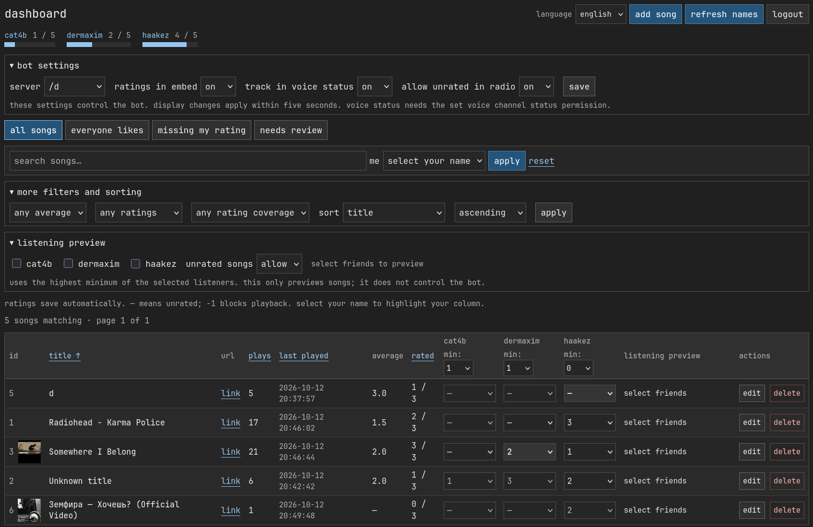

# musicbot

a discord music bot with a shared library, personal ratings, radio, playlist queues, playback across up to three voice channels, and a dashboard for managing songs and ratings.

## dashboard

manage songs and ratings, check listening eligibility, view playback status, and configure radio and backups. open “about” for the command reference, also available through `b!help`.



## run

needs python 3.11+, lavalink v4 saved as `Lavalink.jar`, its required java version, and a discord bot with message content and server members intents enabled.

```bash
python -m venv venv
source venv/bin/activate
pip install -r requirements.txt
cp .env.example .env
# add your tokens and passwords to .env
```

run these in separate terminals:

```bash
# lavalink
source .env
java -jar Lavalink.jar
```

```bash
# bot
source venv/bin/activate
source .env
python main.py
```

```bash
# dashboard
source venv/bin/activate
source .env
python webapp.py
```

open http://127.0.0.1:5000. set `ADMIN_USERNAME`, `ADMIN_PASSWORD`, and `FLASK_SECRET_KEY` in `.env`. the local fallback is `admin` / `password`. `token.txt` works when token environment variables are unset. on nix, use `nix-shell` first.

## commands

```text
b!help
b!add <title or link>
b!play <title, link or search>       # b!p
b!radio                             # b!r
b!queue [page]                      # b!q
b!remove <queue number>
b!move <from> <to>
b!shuffle
b!clear
b!skip                              # b!s
b!stop                              # b!st
b!leave                             # b!l
b!pause                             # b!pa
b!resume                            # b!re
b!seek <seconds>
b!loop [track|queue|off]             # b!lp
b!np
b!minrating <-1–3>                    # b!mr
b!unrated on|off
b!embedratings on|off
b!voicestatus on|off
b!radioinfo
b!rate <-1–3> <title or #song_id>
b!library [page]
b!sync <channel_id> [second_channel_id]
b!unsync
```

playlist links queue all returned tracks. text searches use the first result. `b!add` saves tracks to the library; `b!play` alone does not. `songs.txt` imports one title per line at startup, then empties the file.

## radio

ratings: **-1, 0, 1, 2, 3**. missing ratings are separate from 0.

radio checks each listener’s rating against that person’s own minimum. for example, a rating of 1 with a minimum of 1 and a rating of 3 with a minimum of 3 both pass. averages are not used for eligibility. **-1 blocks a song when that listener’s minimum is 0 or higher. a minimum of -1 allows their -1 ratings.**

`b!unrated on` allows missing ratings; `off` requires everyone to rate the song. manual requests bypass these rules. radio favours less-played songs and cycles through the eligible library. when every matching song has played, it starts another cycle. a single eligible song repeats. unavailable tracks are skipped for five minutes; `b!radio` retries them immediately.

## sync

invite two extra bot accounts with server members intent enabled. add their tokens to `.env` and restart:

```bash
export DISCORD_SYNC_TOKEN_2='second-bot-token'
export DISCORD_SYNC_TOKEN_3='third-bot-token'
```

start playback, then use `b!sync` with one or two channel ids. companions follow the main bot's queue and playback. radio checks everyone across the linked channels. timing is approximate; live streams cannot be aligned by seeking.

## platforms

youtube, soundcloud, bandcamp, twitch, vimeo, and http audio links are configured. lavasrc adds optional spotify and apple music links, using youtube for the actual audio.

set `SPOTIFY_ENABLED=true` with `SPOTIFY_CLIENT_ID` and `SPOTIFY_CLIENT_SECRET`, or `APPLE_MUSIC_ENABLED=true` with `APPLE_MUSIC_TOKEN`. export them before starting java and restart lavalink. other sources need their own configuration: [lavasrc docs](https://github.com/topi314/LavaSrc).

```text
b!play ytsearch:<query>
b!play ytmsearch:<query>
b!play scsearch:<query>
b!play spsearch:<query>
b!play amsearch:<query>
```

## dashboard

“bot settings” controls ratings in the now-playing embed, the track in voice-channel status, and whether radio allows unrated songs. settings are saved per server and match the commands above. display updates apply within five seconds. voice status needs the bot’s “set voice channel status” permission.

- english and russian, inline saves, and per-person progress.
- sorting by title, plays, last played, and rating coverage.
- listening preview showing who blocks a track and why.
- “everyone likes”: everyone rated 2 or 3.
- “missing my rating”: tracks the selected person has not rated.
- “needs review”: missing ratings, disagreements, or unresolved links.
- cached usernames with manual refresh.

**—** clears a rating. apply the view again to refresh filtering after edits. the preview does not change the bot's settings. discord users can edit only their own ratings and minimum. other ratings remain visible; password-only sessions cannot edit ratings.

for remote access, use https and a production server:

```bash
gunicorn --workers 1 --bind 127.0.0.1:5000 webapp:app
```

run everything from the same directory. keep lavalink private. back up `music_bot.db` with sqlite's backup api, or stop both apps before copying it.

## audio sources

song searches try a matching soundcloud recording first, then youtube. matching checks the title but can still select a different upload. explicit links, including saved youtube links, always use the supplied platform and recording. search prefixes also select a platform directly.

```text
b!play scsearch:artist title
b!play ytsearch:artist title
b!play ytmsearch:artist title
b!play spsearch:artist title
b!play amsearch:artist title
b!play <soundcloud, bandcamp, spotify or apple music link>
```

soundcloud and bandcamp provide audio directly. spotify and apple music require their credentials in `.env`; lavasrc resolves their metadata through soundcloud, then youtube. youtube tries the patched ios client before mweb and tvhtml5_simply. ratings stay attached to the library song when another source is selected.

youtube signature decoding uses the public yt-cipher service at `https://cipher.kikkia.dev/`. this is an external dependency; audio still streams through lavalink without downloading songs. set `YOUTUBE_CIPHER_URL` and, if needed, `YOUTUBE_CIPHER_PASSWORD` to use your own [yt-cipher instance](https://github.com/kikkia/yt-cipher). restart lavalink after changing these settings. the helper addresses player-script decoding failures; youtube login requirements can still prevent playback.

the youtube plugin is pinned to development build `6579cdfd8fbfffad7c95b72fc07ff81c11d9e4de` for the upstream ios playback fix, with ios tried before mweb. this is newer development code than stable 1.18.2; playback may still fail as youtube changes. to revert, restore dependency version `1.18.2` and the releases repository in `application.yml`, remove the development youtube jar from `plugins`, and restart lavalink.

all playback uses lavadspx adaptive peak attenuation, including radio and synced channels. it reduces peaks above amplitude `0.4` without boosting quiet recordings. this is not measured lufs normalization; songs can still differ in perceived loudness.

## database backups

the bot creates a consistent sqlite snapshot at startup and every six hours, keeping the latest 28 snapshots in `backups/`. snapshots include songs, ratings, usernames, thresholds, and server settings. they are checked before publication; backup failures are logged without stopping playback.

```bash
# create a backup now, including while the bot is running
python backup_db.py
# choose another destination or retention count
python backup_db.py --directory /path/to/backups --keep 28
```

set the backup interval (1–168 hours) under “automatic backups” in the dashboard. changes apply within 30 seconds. `DB_BACKUP_HOURS` supplies the initial default; saved dashboard settings take precedence. `DB_BACKUP_DIR` and `DB_BACKUP_KEEP` in `.env` control destination and retention. automatic backups run while the bot is running. keep a copy on another disk or machine to protect against disk failure.

```bash
# restore: stop the bot and dashboard first, then preserve the current database
python backup_db.py
# replace the example snapshot path with the backup to restore
python - <<'PY'
import sqlite3
from contextlib import closing
with closing(sqlite3.connect('file:backups/music_bot-YYYYMMDDTHHMMSSffffffZ.sqlite3?mode=ro', uri=True)) as source:
    with closing(sqlite3.connect('music_bot.db')) as destination:
        source.backup(destination)
PY
# restart the bot and dashboard
```

now-playing messages show source, artwork when available, duration, play count, and requester details for manual requests. `b!embedratings on|off` or the dashboard setting controls the ratings section. the bot retains its latest three track messages per server during a run so earlier tracks can still be rated; -1 on an older track does not skip a different current song. messages from before a bot restart are not registered again.

in the dashboard, a song can have only a link and no title. its title and artwork are filled from source metadata when playback starts. supplied titles are preserved. cover thumbnails appear beside song ids after artwork has been resolved.

## dashboard status and radio

“keep radio connected and retry” in bot settings keeps active radio connected when the channel is empty or no eligible songs remain. eligible songs already repeat after each cycle. while waiting, radio rechecks every 15 seconds and resumes when listeners return or ratings allow playback. source failures still keep their five-minute cooldown. explicit stop and leave commands remain available; this does not reconnect a bot that was forcibly disconnected.

the dashboard shows discord, lavalink, and voice connection status, the current track, pause state, source, and listener count. status refreshes about every five seconds; a heartbeat older than 20 seconds is marked outdated.

“similar links” finds entries pointing to the same recording, including youtube short/watch/embed links and common tracking variations. it does not compare audio across different uploads. “new songs” shows additions from the last seven days; date-added sorting is also available. timestamps are recorded for new entries; existing entries with unknown dates are excluded from the new-songs view.

search accepts titles, exact ids such as `#123`, full links, and partial links. full youtube links also match alternate url formats for the same video. “duplicate finder” lists possible duplicates by normalized link or similar title and shows the matching ids. review recordings before deleting: similar titles can belong to different versions, and ratings are not merged automatically.

## playback controls and history

now-playing messages include pause/resume, skip, and replay buttons. controls require a listener in a linked voice channel and apply only when that recording is current. dashboard controls are available to signed-in users and show whether the bot completed the action. replay seeks to the start without removing queued songs; live streams cannot be replayed.

```text
b!replay
b!history
```

recent history is saved in sqlite: the dashboard shows the latest 50 entries for the selected server, and `b!history` shows ten. up to 500 entries per server are retained, including failed playback attempts. play counts still increment on track start.

manual `b!play` searches offer up to five recordings to the requester, with a 60-second selection timeout. links and playlists are queued directly. radio keeps its automatic selection.

## bulk import and metadata

open “bulk import” to paste one title or link per line, or upload UTF-8 text, CSV, or TSV. CSV/TSV headers are `title,url`. the preview marks invalid entries and duplicate names/links, and you choose which entries to save. imports are limited to 5000 entries and 2 mb; preview confirmation expires after one hour. existing recording links are rechecked at confirmation and skipped without changing ratings.

changing a song's recording link clears its old cover and, if the title was left unchanged, clears the old title for resolution on the next playback. manually supplied replacement titles are kept. alternate URL formats for the same recording preserve metadata. duplicate recording links and invalid play counts return a form error.

## optional slash commands

```bash
export ENABLE_SLASH_COMMANDS=true
python main.py
```

this registers `/play`, `/radio`, `/queue`, `/np`, `/history`, `/replay`, `/pause`, `/resume`, and `/skip` globally. discord must authorize the bot's application commands, and global registration can take time to appear. prefix commands continue to work. `/play` uses the same result selection as `b!play`. the flag controls registration on startup; turning it off does not unregister commands already published to discord.

## discord dashboard login

`.env` is a plain text file containing shell exports. create it from `.env.example`, edit it, then load it in each terminal before starting a service:

```bash
cp .env.example .env
# edit .env with your editor
nix-shell
source .env
python webapp.py
```

for remembered logins, keep a permanent random `FLASK_SECRET_KEY` in `.env`. generate a value and paste it into that setting:

```bash
python -c 'import secrets; print(secrets.token_hex(32))'
```

1. open your application in the [discord developer portal](https://discord.com/developers/applications).
2. under oauth2, copy its client id and client secret into `DISCORD_OAUTH_CLIENT_ID` and `DISCORD_OAUTH_CLIENT_SECRET`. the client secret is not the bot token.
3. register the exact redirect URL and put the same URL in `DISCORD_OAUTH_REDIRECT_URI`. locally, use `http://127.0.0.1:5000/auth/discord/callback`; publicly, use `https://your-address/auth/discord/callback`.
4. put your own discord user id and each allowed person's id in `DISCORD_ALLOWED_USER_IDS`.
5. for public https hosting, set `FLASK_COOKIE_SECURE=true`. use false only for local http development.
6. load `.env` and restart the dashboard.

```bash
export DISCORD_ALLOWED_USER_IDS='111111111111111111,222222222222222222'
export DASHBOARD_LOGIN_DAYS='30'
```

**add more people:** edit `DISCORD_ALLOWED_USER_IDS` in `.env`, append another id separated by a comma, then run `source .env` and restart the dashboard. to copy a user id in discord, enable developer mode in settings, then right-click the person and choose “copy user id”. usernames are not used for access decisions.

with discord login configured, password login is disabled and only allowlisted accounts can enter. removed accounts are rejected after the configuration is reloaded, even with a remembered login. the login requests only the `identify` scope and does not save oauth access or refresh tokens in the browser session. ratings and personal minimums can be edited only by their Discord owner. other dashboard controls remain shared among admitted users.

“remember me” keeps login for 30 days by default, including after dashboard restarts when the secret key remains the same. unchecking it uses a browser-session cookie with a 12-hour server expiry. logout clears the browser session. remembered login requires the browser to retain cookies.

“refresh” reloads dashboard data with the applied filters and selected server. it waits for active rating saves and playback actions before allowing a reload.

## temporary sharing for friends

configure discord client id/secret, `DISCORD_ALLOWED_USER_IDS`, and a permanent `FLASK_SECRET_KEY` in `.env` first. the launcher refuses to expose the password-only dashboard. the callback URL is set automatically for this temporary process.

```bash
nix-shell
pip install -r requirements.txt
./share-dashboard.sh
```

the script loads `.env`, opens a [cloudflare quick tunnel](https://developers.cloudflare.com/tunnel/get-started/quick-tunnels/), and starts a separate gunicorn dashboard on localhost. it prints a temporary https address and its exact oauth callback. add that callback under oauth2 → redirects in the discord developer portal, save, then share the dashboard address with your allowed friends.

keep the terminal open. ctrl+c stops the tunnel and its dashboard, while the bot and lavalink continue running. the URL changes every run, so register the new callback each time. a new hostname also means signing in again, even if login was remembered on the previous hostname. this is a testing setup, not permanent hosting. quick tunnels require no cloudflare account or purchased domain, and have no uptime guarantee.

if you entered nix-shell before cloudflared was added, leave it and run `nix-shell` again. existing cloudflared config files can conflict with quick tunnels; the script will report that rather than modifying them.

## links and rating colors

video links are cleaned automatically on playback and when added or edited: attached youtube playlists, channel labels, and tracking parameters are removed. standalone playlist links still import/play playlists. start times are kept as `t=<seconds>`; formats such as `t=90`, `t=1m30s`, `start=90`, and `#t=90` work in manual playback and radio. a start outside the recording is rejected. arbitrary stream links retain parameters that may be needed for playback.

ratings use muted purple (3), green (2), yellow (1), gray (0), and red (-1). unrated entries remain separate. the server checks ownership when saving ratings and minimums, including manually crafted requests.

minimum options are exactly `-1, 0, 1, 2, 3`. each listener’s own rating is compared with their own minimum. legacy fractional minima round upward to preserve which integer ratings qualify.
